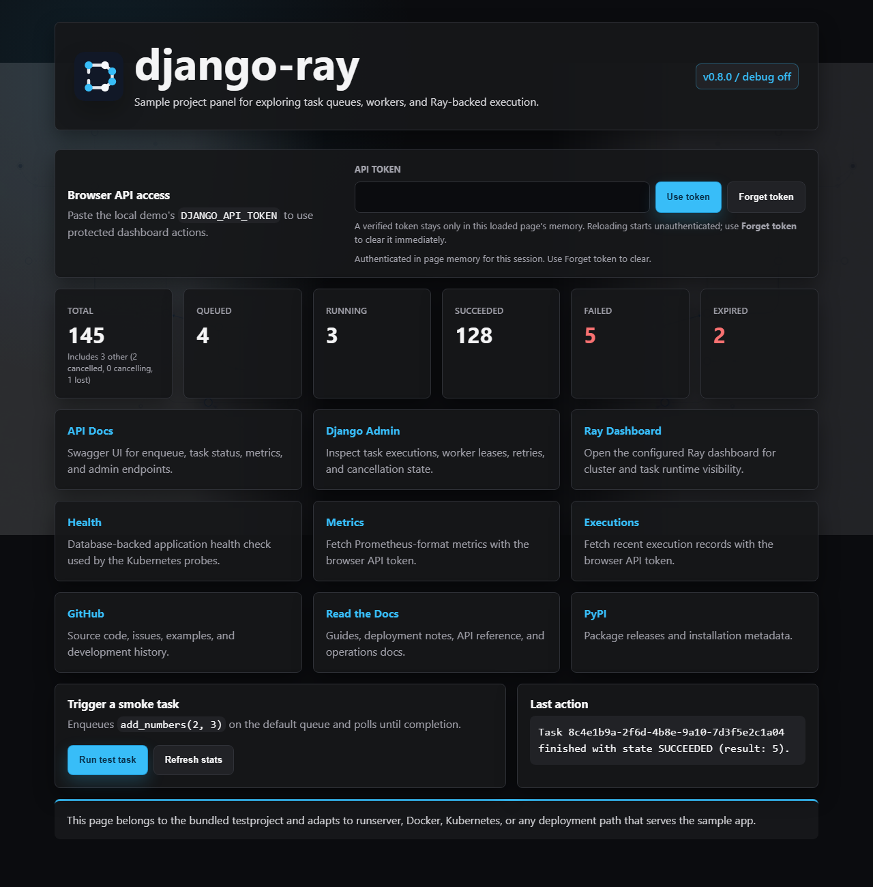
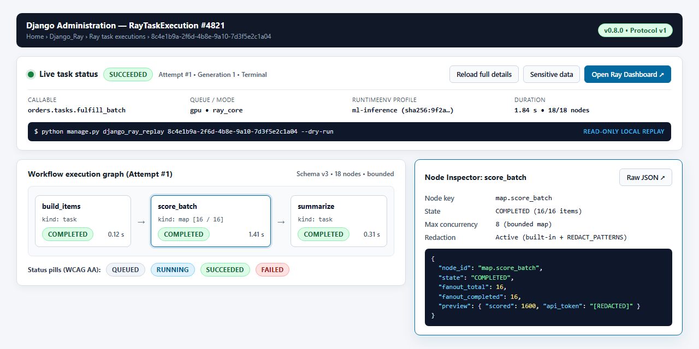

<p align="center">
  
</p>

<h1 align="center">django-ray</h1>

<p align="center">
  A Ray-based backend for <a href="https://github.com/django/django">Django Tasks</a> that enables distributed task execution with database-backed reliability.
</p>

<p align="center">
  <a href="https://github.com/dariuszpanas/django-ray/actions/workflows/ci.yml"></a>
  <a href="https://github.com/dariuszpanas/django-ray/actions/workflows/docs.yml"></a>
  <a href="https://pypi.org/project/django-ray/"></a>
  <a href="https://github.com/dariuszpanas/django-ray/blob/main/LICENSE"></a>
</p>

## Why django-ray?

Django projects often need background task execution. While Celery has been the go-to solution for years, [Ray](https://ray.io) offers a more powerful and flexible approach to distributed computing:

- **True distributed computing**: Ray was built for distributed workloads from the ground up, not just task queues
- **Horizontal scaling**: Scale from a single machine to thousands of nodes without changing your code
- **Resource-aware scheduling**: Request specific CPU, GPU, or memory for tasks via `@ray_task`
- **Ray Core tasks & workflows**: Run stateless tasks, coroutines, and Ray-native workflow DAGs behind one durable Django boundary (and invoke Ray Actors inside application-owned code when needed; django-ray does not yet expose a first-class actor pool API)
- **Explicit Ray ecosystem boundary**: Run Ray Data, Train, Tune, or RLlib in
  application-owned code after installing its component extra; keep online serving on
  Ray Serve's separate lifecycle. These are not first-class adapters in django-ray.

Despite Ray's capabilities, there was no straightforward way to use it with Django's built-in Tasks framework. django-ray bridges this gap, letting you leverage Ray's distributed computing power while keeping Django's familiar patterns and database-backed reliability.

Moving an existing workload? Use
[Migrating from Celery](https://django-ray.readthedocs.io/en/latest/celery-migration/) to classify
semantic gaps, run both backends during adoption, and prove the old queue is drained.

## Overview

django-ray bridges Django's built-in Tasks framework with Ray's distributed computing capabilities, providing:

- **Durable visibility and recovery**: Task state remains in your Django database so workers and
  operators can reconcile lost or stuck execution; queued work can expire or be cancelled before
  it starts, while work that does start may be replayed after uncertain completion, so side effects
  must be idempotent
- **Native Django 6 Tasks parity**: Supports `@task`, `@task(takes_context=True)` (`TaskContext`),
  declarative `@ray_task` resource/retry contracts, and `django.tasks.signals` (`task_enqueued` via
  `transaction.on_commit()`, plus `task_started` and `task_finished`)
- **Multiple execution modes**: Sync (`--sync`), local Ray Core (`--local`), remote Ray Core
  (`--cluster=ADDRESS`), or isolated Ray Job Submission API (`--ray-job`)
- **Coroutine tasks**: Await Django async task functions, workflow steps, and distributed helpers consistently in every mode
- **Automatic retries with jitter**: Failed tasks are retried with exponential backoff, bounded jitter, and exception denylists
- **Fail-loud oversized results**: Accessing `.return_value` on an unavailable or digest-only oversized result raises `ResultUnavailableError` instead of silently returning `None`
- **Admin visibility & local debugging**: Monitor, cancel, and retry tasks through Django admin, inspect terminal workflow graphs, and debug locally with read-only `django_ray_replay`
- **Worker lifecycle & retention controls**: Database-clock leases, graceful `--drain` handoff, exit-0 Linux `django_ray_doctor`, and bounded `django_ray_purge_executions`
- **Django-durable workflows on Ray Core**: Chain, group, and dynamically fan out
  low-overhead internal steps behind one durable Django task (with `explain_workflow` dry-run inspection); this is unrelated to the
  former, removed `ray.workflow` package
- **RuntimeEnv profiles**: Run versioned or lightweight Python environments on a
  generic Ray cluster, with immutable environment identity per durable task
- **Operational observability**: Use versioned task services, bounded-cardinality
  Prometheus metrics, optional OpenTelemetry tracing (`django-ray[otel]`), and authenticated live updates in Django admin

The repository includes a sample `testproject/` with a small landing page for exploring the bundled API,
task stats, project links, and smoke-task trigger:



Django Admin provides top-of-page live task status, read-only local replay commands, and
bounded terminal workflow DAG inspection with WCAG-AA status badges:



## Requirements

- Python 3.12, 3.13, or 3.14
- Django 6.0.8+
- Ray 2.60.0+ for the 0.8.0 baseline (released 0.7.x uses 2.58.0+)

Python 3.15 has a preparatory compatibility check without Ray Core. Full runtime
support remains blocked by upstream Ray wheels; use Python 3.12–3.14 for installation
and execution. See the [Python 3.15 policy](https://django-ray.readthedocs.io/en/latest/compatibility/#python-315-preparation).

> **Upgrading an existing Beta deployment?** Beta releases use a coordinated stopped-writer
> upgrade (pause producers, drain active queues with `django_ray_worker --drain`, back up database
> and artifacts, apply migrations including `0029_lease_engine_and_hot_indexes`, and replace all
> components together). See the
> [0.7.1 to 0.8.0 upgrade guide](https://django-ray.readthedocs.io/en/latest/deployment/upgrading-from-0.7/),
> the [0.6 to 0.7 upgrade guide](https://django-ray.readthedocs.io/en/latest/deployment/upgrading-from-0.6/),
> and the [changelog](https://django-ray.readthedocs.io/en/latest/changelog/).

## Installation

```bash
pip install django-ray
```

Or with uv:

```bash
uv add django-ray
```

Optional extras: `django-ray[postgres]`, `django-ray[s3]`, `django-ray[gcs]`,
`django-ray[object-storage]`, and `django-ray[otel]` (`opentelemetry-sdk>=1.45.1` for exporting
OpenTelemetry traces when `TRACING_ENABLED=True`).

The base package installs `ray[default]` for Ray Core, Ray Client, Ray Jobs, and live
Dashboard/State diagnostics. It does not install usable Ray Data, Train, Tune, RLlib,
Serve, Serve LLM, or native Compiled Graph dependencies. Review the
[Ray Ecosystem Support and Install Matrix](https://django-ray.readthedocs.io/en/latest/ray-ecosystem/)
before adding one of those components to a task image or RuntimeEnv.

## Quick Start

1. Add `django_ray` to your `INSTALLED_APPS`:

```python
INSTALLED_APPS = [
    # ...
    "django_ray",
]
```

2. Configure Django Tasks and django-ray:

```python
TASKS = {
    "default": {
        "BACKEND": "django_ray.backends.RayTaskBackend",
        "QUEUES": ["default"],
    },
}

DJANGO_RAY = {
    "RAY_ADDRESS": "auto",  # Use "ray://host:port" for bounded remote Ray Core work
    "RUNNER": "ray_core",
    "DEFAULT_CONCURRENCY": 10,
    "MAX_TASK_ATTEMPTS": 3,
}
```

3. Run migrations:

```bash
python manage.py migrate django_ray
```

4. Define a task in `myapp/tasks.py`:

```python
from django.tasks import task


@task(queue_name="default")
def add_numbers(left: int, right: int) -> int:
    return left + right
```

5. In a separate terminal, start the worker:

```bash
# Local Ray (recommended for development)
python manage.py django_ray_worker --queue=default --local

# Connect through Ray Client for bounded, low-latency work
python manage.py django_ray_worker --queue=default --cluster=ray://localhost:10001

# Sync mode (no Ray, for testing)
python manage.py django_ray_worker --queue=default --sync
```

6. Enqueue the task from `python manage.py shell`:

```python
from myapp.tasks import add_numbers

enqueued = add_numbers.enqueue(20, 22)
print(enqueued.id)
```

After the worker reports completion, refresh the durable result in the same shell:

```python
from django.tasks import TaskResultStatus, task_backends

current = task_backends["default"].get_result(enqueued.id)
if current.status == TaskResultStatus.SUCCESSFUL:
    print(current.return_value)  # 42
```

The object returned by `enqueue()` is a snapshot; call `get_result()` again when you need current
state. Continue with
[Getting Started](https://django-ray.readthedocs.io/en/latest/getting-started/) for the complete
walkthrough and its before-production checklist.

## Worker Execution Modes

| Mode | Flag | Description |
|------|------|-------------|
| **sync** | `--sync` | Direct execution, no Ray (testing) |
| **local** | `--local` | Local Ray cluster, tasks via `@ray.remote` |
| **cluster** | `--cluster=<addr>` | Bounded low-latency work through Ray Client |
| **ray-job** | `--ray-job` (or `RUNNER="ray_job"`) | Ray Job Submission API (process isolation) |

Without a mode flag, the worker uses `DJANGO_RAY["RUNNER"]`, which defaults to `"ray_core"` with
`RAY_ADDRESS="auto"` (starting or attaching to local Ray out of the box). For remote Kubernetes
workloads, start with **Ray Job** (`--ray-job` / `RUNNER="ray_job"` plus a retrievable
`INPUT_STORAGE_BACKEND`) when driver isolation or task-manager restart survival matters; choose
**Cluster Ray Core** (`--cluster=ray://...`) when lower per-task latency matters for bounded short
work and dynamic workflows. See
[durable input storage](https://django-ray.readthedocs.io/en/latest/reference/input-storage/).

Cluster mode is tied to the task manager's Ray Client connection. If that connection
is lost beyond Ray's reconnect grace period, Ray terminates its in-flight workload;
django-ray can reconcile and retry the outer task, but it does not resume completed
workflow leaves or roll back side effects. Use idempotent work and prefer Ray Job mode
for long or coarse execution that must continue independently of the submitting
connection. See Ray's
[Ray Client lifetime guidance](https://docs.ray.io/en/latest/cluster/running-applications/job-submission/ray-client.html).

## Configuration

| Setting | Default | Description |
|---------|---------|-------------|
| `RAY_ADDRESS` | `"auto"` | Ray address (`"auto"` locally, `"ray://host:port"` for Ray Client, or HTTP(S) Jobs URL; not required for `--sync`) |
| `RUNNER` | `"ray_core"` | Worker mode when no explicit mode flag is supplied (`"ray_core"` or `"ray_job"`) |
| `DEFAULT_CONCURRENCY` | `10` | Max concurrent tasks per worker |
| `WORKER_POLL_MAX_INTERVAL_SECONDS` | `1.0` | Max idle polling delay with adaptive backoff (base `0.1s`) |
| `MAX_TASK_ATTEMPTS` | `3` | Max retry attempts |
| `RETRY_BACKOFF_SECONDS` | `60` | Base backoff for retries |
| `RETRY_BACKOFF_JITTER_RATIO` | `0.1` | Bounded downward random jitter (`[-10%, 0%]`) applied to retry backoff |
| `RETRY_EXCEPTION_DENYLIST` | `[]` | Exception types that skip auto-retry |
| `STUCK_TASK_TIMEOUT_SECONDS` | `300` | Timeout before marking tasks as LOST |
| `TASK_MONITOR_HEARTBEAT_SECONDS` | `15` | Database heartbeat interval for in-flight Ray Core tasks |
| `RUNTIME_ENV_PROFILES` | `{}` | Named Ray environments for code and dependencies |
| `DEFAULT_RUNTIME_ENV_PROFILE` | `None` | Default named environment |
| `MAX_INLINE_INPUT_SIZE_BYTES` | `None` | Opt-in durable input spillover threshold |
| `RESULT_STORAGE_BACKEND` | `"digest"` | Oversized (>1 MiB) result backend (`"digest"`, `"filesystem"`, `"s3"`, `"gcs"`); accessing `.return_value` on an unavailable digest stub raises `ResultUnavailableError` |

See [Ray-Native Workflows](https://django-ray.readthedocs.io/en/latest/workflows/) for low-latency `chain`, `group`,
`map_step`, and `explain_workflow` execution.
See [Django Gateway to Private Ray Serve](https://django-ray.readthedocs.io/en/latest/ray-serve-gateway/)
for bounded authenticated online inference without writing a FastAPI ingress or adding
package-owned Serve orchestration.
See [Runtime Environments](https://django-ray.readthedocs.io/en/latest/runtime-environments/) for per-task profiles,
workflow overrides, and generic KubeRay images.
See [Performance](https://django-ray.readthedocs.io/en/latest/performance/) for choosing durable task boundaries,
execution modes, and useful fan-out granularity.
See [Durable Input Storage](https://django-ray.readthedocs.io/en/latest/reference/input-storage/) for oversized JSON
arguments, storage backends, rollout, and retention.
See [Defining Tasks](https://django-ray.readthedocs.io/en/latest/tasks/#coroutine-tasks) for `@ray_task`,
async task, `TaskContext`, and `django.tasks.signals` guidance.

For bounded read-only Linux diagnosis, use
[`django_ray_doctor`](https://django-ray.readthedocs.io/en/latest/reference/doctor/):
it exits **`0`** when all required configuration and database observations are healthy (while listing
deferred remote-inventory sections explicitly), **`1`** on blockers, and **`2`** on incomplete
required checks or cleanup issues. Use
[`django_ray_replay`](https://django-ray.readthedocs.io/en/latest/reference/cli/#django_ray_replay)
for read-only local debugging (`--dry-run` / `--pdb`),
[`django_ray_purge_executions`](https://django-ray.readthedocs.io/en/latest/reference/cli/#django_ray_purge_executions)
for bounded retention cleanup, and `django_ray_worker --drain` for graceful upgrade draining.

## Development Setup

### Prerequisites
- Python 3.12, 3.13, or 3.14
- [uv](https://github.com/astral-sh/uv) package manager

### Installation

```bash
git clone https://github.com/dariuszpanas/django-ray.git
cd django-ray
make install
```

### Development Commands

Run development targets through `uv run` unless the virtual environment is already active. Targets
named `lint`, `check`, and `ci` are non-mutating; use `format` or `fix` when files should change.

```bash
make install          # Install locked Python and commit-policy dependencies
uv run make format    # Format code with Ruff
uv run make fix       # Format and apply safe Ruff lint fixes
uv run make lint      # Check lint without modifying files
uv run make typecheck # Type check with ty
uv run make test      # Run tests
uv run make test-xdist # Run the default-resource subset with four xdist workers
uv run make test-cov  # Run tests with CI coverage floors
uv run make check     # Check formatting, lint, and types without changes
uv run make ci        # Check coverage, docs, and package build for this interpreter
uv run make docs-build       # Build docs (Zensical)
uv run make docs-build-strict # Build docs in strict mode
uv run make docs-serve       # Serve docs locally
```

### Django Commands

```bash
uv run make migrate          # Run migrations
uv run make runserver        # Start dev server
uv run make shell            # Django shell
uv run make createsuperuser  # Create admin user
```

### Worker Commands

```bash
uv run make worker           # Default RUNNER="ray_core" mode (local Ray via RAY_ADDRESS="auto")
uv run make worker-local     # Native local Ray for single-host development
uv run make worker-sync      # Sync mode (no Ray)
uv run make worker-all       # All django-ray backend queues, local Ray
uv run make worker-cluster   # Connect to cluster
```

Linux is the supported execution target. Use an explicitly bounded Linux environment
for execution and full-suite validation. Windows compatibility is best effort through
advisory GitHub Actions checks; do not run native Ray validation on a Windows workstation. See the
[platform compatibility boundary](https://django-ray.readthedocs.io/en/latest/compatibility/#platforms)
for host-side development options.

### Quick Start (End-to-End Testing)

Generate a disposable bearer token in the shell that will start Django, then migrate the database.
On POSIX:

```bash
export DJANGO_API_TOKEN="$(
  uv run python -c 'import secrets; print(secrets.token_urlsafe(32))'
)"
uv run make migrate
```

On PowerShell:

```powershell
$env:DJANGO_API_TOKEN = uv run python -c "import secrets; print(secrets.token_urlsafe(32))"
uv run make migrate
```

Start the web process and worker in separate terminals that share the same project checkout and
database:

```bash
uv run make runserver
uv run make worker-all
```

**Browser - Test via API:**

1. Open http://127.0.0.1:8000/api/docs (Swagger UI)
2. Select **Authorize** and paste the generated token value
3. Try `POST /api/enqueue/add/100/200`
4. Refresh `GET /api/tasks/{task_id}`, then check `GET /api/executions`
5. View in Admin: http://127.0.0.1:8000/admin/django_ray/raytaskexecution/

The tracked Docker Compose path below is the reproducible bundled-application smoke, including
PostgreSQL and migration ordering.

### Queue Configuration

With the package default `RUNNER="ray_core"` and `RAY_ADDRESS="auto"`, the commands below start
or attach to local Ray out of the box. When selecting Ray Job mode (`--ray-job` or
`RUNNER="ray_job"`), configure a retrievable `INPUT_STORAGE_BACKEND` (including its filesystem
root or object-store namespace) first, because new rq2 submissions always externalize the
canonical execution request.

```bash
# Single queue
uv run python testproject/manage.py django_ray_worker --queue=default

# Multiple queues
uv run python testproject/manage.py django_ray_worker --queue=default,high-priority,low-priority

# All queues configured on django-ray backend aliases
uv run python testproject/manage.py django_ray_worker --all-queues

# Graceful drain for coordinated upgrades
uv run python testproject/manage.py django_ray_worker --queue=default --drain
```

## Docker

The canonical local evaluation path is the tracked Compose application. Generate the required
disposable credentials, start the web and worker services, then run the bounded end-to-end smoke:

```bash
export DJANGO_API_TOKEN="$(
  uv run python -c 'import secrets; print(secrets.token_urlsafe(32))'
)"
export POSTGRES_PASSWORD="$(
  uv run python -c 'import secrets; print(secrets.token_urlsafe(32))'
)"

docker compose up --build --detach web worker
docker compose --profile smoke run --rm --no-deps smoke
```

PowerShell, authenticated request, result-refresh, admin, and cleanup commands are in the
[bundled testproject quickstart](https://github.com/dariuszpanas/django-ray/blob/main/testproject/README.md). The local Compose topology and its generated
credentials are not production hardening.

## Kubernetes Deployment

Evaluate the bundled Kustomize manifests in `k8s/` only on a trusted, disposable local
environment. They are maintainer-validation assets, not a production-ready deployment, and
replacing their placeholder values does not make the sample topology production-ready.

```bash
# Build images
make k8s-build

# Deploy
make k8s-deploy

# Check status
make k8s-status

# With TLS enabled
make k8s-gen-tls-certs
make k8s-deploy-tls
```


See [k8s/README.md](https://github.com/dariuszpanas/django-ray/blob/main/k8s/README.md) for detailed deployment documentation.

## Project Structure

```
django-ray/
├── src/django_ray/          # Library source code
│   ├── models.py            # RayTaskExecution, TaskAttempt, TaskWorkerLease
│   ├── decorators.py        # @ray_task declarative task contracts
│   ├── backends.py          # Django Tasks backend & fail-loud RayTaskResult
│   ├── _blob_storage.py     # Unified internal blob storage engine
│   ├── admin.py             # Admin registrations & thin views
│   ├── admin_views/         # Modular admin badges, actions, diagnostics & sensitive views
│   ├── worker/              # Modular worker loop, claimer, dispatcher, reconciler & shutdown
│   ├── workflow/            # Plan contracts, strategies, DSL (explain_workflow) & progress
│   ├── conf/                # Defaults, settings & validation
│   ├── runner/              # SyncRunner, RayCoreRunner, RayJobRunner, leasing & retry
│   ├── runtime/             # Entrypoint, distributed helpers, RuntimeEnv & serialization
│   ├── doctor/              # Bounded Linux read-only diagnostics
│   └── management/commands/ # worker, doctor, replay, purge_executions, lease_policy, etc.
│
├── testproject/             # Example project (development only)
│   ├── api.py               # Example REST API
│   ├── tasks.py             # Example tasks
│   └── apps/                # Example apps
│
├── tests/                   # Test suite
├── docs/                    # Documentation
└── k8s/                     # Kubernetes manifests (local evaluation only)
```

## Documentation

Published docs are served with Zensical at:

- https://django-ray.readthedocs.io/en/latest/

Agents and documentation tools can start with
[`llms.txt`](https://django-ray.readthedocs.io/en/latest/llms.txt). The published
documentation also serves `/llms.txt`.

Read the Docs builds are configured in `.readthedocs.yaml`. The build installs `uv`, runs the
strict Zensical build, and copies the generated `site/` output into Read the Docs' HTML output
directory.

Source docs remain in the [`docs/`](https://github.com/dariuszpanas/django-ray/tree/main/docs) directory:

- [Getting Started](https://github.com/dariuszpanas/django-ray/blob/main/docs/getting-started.md) - Installation and basic setup
- [Configuration](https://github.com/dariuszpanas/django-ray/blob/main/docs/configuration.md) - All configuration options
- [Worker Modes](https://github.com/dariuszpanas/django-ray/blob/main/docs/worker-modes.md) - Execution modes explained
- [Ray Ecosystem Support](https://github.com/dariuszpanas/django-ray/blob/main/docs/ray-ecosystem.md) -
  Component installs, durable exchange, lifecycle ownership, and evidence
- [Tasks](https://github.com/dariuszpanas/django-ray/blob/main/docs/tasks.md) - Defining and enqueueing tasks
- [Queues](https://github.com/dariuszpanas/django-ray/blob/main/docs/queues.md) - Working with task queues
- [Retry & Error Handling](https://github.com/dariuszpanas/django-ray/blob/main/docs/retry.md) - Configuring retries
- [Migrating from Celery](https://github.com/dariuszpanas/django-ray/blob/main/docs/celery-migration.md) -
  Classifying workloads, running both backends, and draining Celery safely

### Deployment

- [Kubernetes](https://github.com/dariuszpanas/django-ray/blob/main/docs/deployment/kubernetes.md) - Deploy to Kubernetes
- [Docker](https://github.com/dariuszpanas/django-ray/blob/main/docs/deployment/docker.md) - Running with Docker
- [TLS](https://github.com/dariuszpanas/django-ray/blob/main/docs/deployment/tls.md) - Securing Ray communication

### Reference

- [CLI Reference](https://github.com/dariuszpanas/django-ray/blob/main/docs/reference/cli.md) - Command-line options
- [Settings Reference](https://github.com/dariuszpanas/django-ray/blob/main/docs/reference/settings.md) - All settings
- [API Reference](https://github.com/dariuszpanas/django-ray/blob/main/docs/reference/api.md) - REST API endpoints

## Contributing

See [`CONTRIBUTING.md`](https://github.com/dariuszpanas/django-ray/blob/main/CONTRIBUTING.md) for
branch, commit, pull request, staging, and validation conventions. Automated contributors must also
follow [`AGENTS.md`](https://github.com/dariuszpanas/django-ray/blob/main/AGENTS.md).

## Security

Report suspected vulnerabilities through the private channel in
the [security policy](https://github.com/dariuszpanas/django-ray/security/policy). Do not put
vulnerability details, exploit instructions, credentials, or secrets in a public issue.

## License

This project is licensed under the BSD 3-Clause License - see the [LICENSE](https://github.com/dariuszpanas/django-ray/blob/main/LICENSE) file for details.

