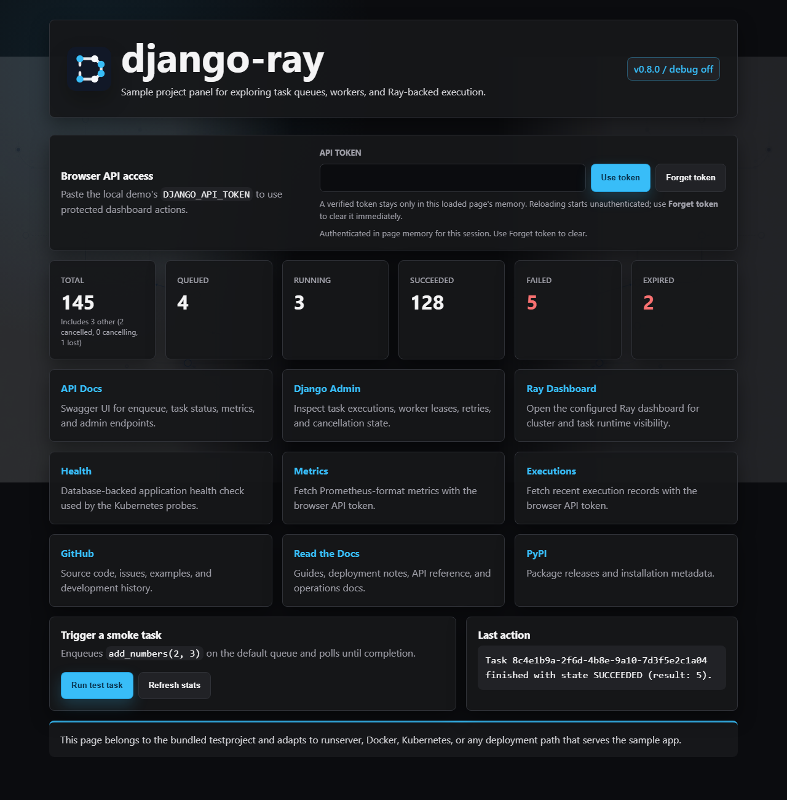
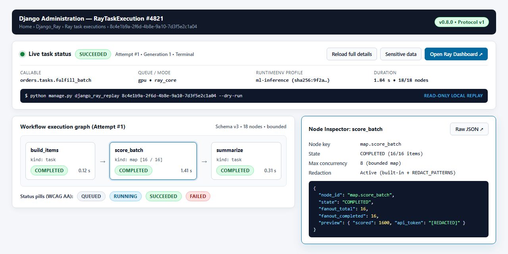

# django-ray Documentation

Welcome to the django-ray documentation. django-ray is a Ray-based backend for Django Tasks that enables distributed task execution with database-backed reliability.

## What is django-ray?

django-ray is a **library** that provides:

- `RayTaskBackend` & fail-loud `RayTaskResult` - A Django 6 Tasks backend with `TaskContext`, `@ray_task` contracts, and `django.tasks.signals`
- `RayTaskExecution` & `TaskAttempt` models - Durable execution and retry history in your database
- `TaskWorkerLease` model - Database-clock worker coordination for distributed deployments
- `django_ray_worker`, `django_ray_doctor`, `django_ray_replay`, & `django_ray_purge_executions` commands
- Django Admin integration - Live task status, terminal workflow DAG graphs, and permission-gated diagnostics

!!! note "Bundled sample project boundary"

    This repository also contains a `testproject/` directory with example code demonstrating django-ray features. The testproject (including its REST API) is **not part of the django-ray library** — it is provided for learning and local evaluation only.

The bundled testproject includes a landing page that links to the sample API, admin, Ray dashboard,
project resources, task stats, and a smoke-task trigger:

In Django Admin, task detail pages pair top-of-page live status polling with bounded,
redacted terminal workflow DAG graphs and an in-Admin Node Inspector:

## Getting Started & Core Concepts

- [Getting Started](getting-started.md) - Installation, quick start, and before-production checklist
- [Task Definition](tasks.md) - Defining `@task`/`@ray_task`, coroutines, `TaskContext`, signals, and enqueue patterns
- [Queues](queues.md) - Workload isolation, priority ordering, and multi-queue workers
- [Retry & Error Handling](retry.md) - Exponential backoff with jitter, denylists, and idempotent side effects
- [Configuration](configuration.md) - Mode selection matrix and `DJANGO_RAY` settings overview

## Execution & Workflows

- [Worker Modes](worker-modes.md) - Sync, Local Ray Core, Cluster Ray Core, and Ray Job trade-offs
- [Ray-Native Workflows](workflows.md) - `step`, `chain`, `group`, `map_step`, `explain_workflow` DSL, and bounded progress
- [Runtime Environments](runtime-environments.md) - Captured dependencies, encrypted snapshots, and maintenance
- [Ray Data Batch Jobs](ray-data.md) - Application-owned finite Ray Data batch transforms

## Operations & Observability

- [Operator Runbook](runbook.md) - Incident playbooks, queries, retention purge, and safe manual recovery
- [Observability](observability.md) - Versioned services, Prometheus metrics, OpenTelemetry `[otel]`, logging, and live admin updates
- [Performance](performance.md) - Choosing task boundaries, batching, polling, and RuntimeEnv strategy
- [Upgrade from 0.7.1 to 0.8.0](deployment/upgrading-from-0.7.md) - Coordinated Beta upgrade and rollback boundaries

## Migration & Ecosystem

- [Migrating from Celery](celery-migration.md) - Workload classification, coexistence, semantic rewrites, and safe Celery drain
- [Ray Ecosystem Support](ray-ecosystem.md) - Component installs, durable exchange, lifecycle ownership, evidence, and adoption gates
- [Django Gateway to Private Ray Serve](ray-serve-gateway.md) - Authenticated, bounded online inference through the private Serve data plane
- [Compatibility](compatibility.md) - Supported versions, CI policy, `uv` prerelease notes, and platform limits
- [Stability and Deprecation](stability.md) - Candidate 1.0 contract and removal policy

## Deployment

- [Docker](deployment/docker.md) - Running with Docker Compose
- [Kubernetes Deployment](deployment/kubernetes.md) - Local evaluation overlays, KubeRay + S3/GCS storage blueprint, and production checklist
- [TLS Configuration](deployment/tls.md) - Securing Ray cluster communication
- [Local Credentials](deployment/local-credentials.md) - Disposable local Kubernetes credential preparation

## Reference

- [CLI Reference](reference/cli.md) - All `django_ray_*` management commands and options
- [Read-only Doctor](reference/doctor.md) - Bounded Linux diagnostics, exit codes, and remediations
- [Settings Reference](reference/settings.md) - Complete `DJANGO_RAY` and `RAY_DASHBOARD_URL` reference
- [Durable Input Storage](reference/input-storage.md) - Oversized JSON input storage, rq2 requests, and cleanup
- [Result Storage](reference/result-storage.md) - Oversized result backends, `ResultUnavailableError`, and rotation
- [Handle Compatibility](reference/handle-compatibility.md) - Ray Core handle formats and migration policy
- [API Reference](reference/api.md) - How to build your own API (with testproject examples)
- [Changelog](changelog.md) - Release history

## Development & Internals

- [Architecture](architecture.md) - Control-plane, lease engine, storage, and modular package design
- [Workflow Plan Contract](workflow-plans.md) - Versioned plan vocabulary, classification, identity, and strategy eligibility
- [Compiled Graph Compatibility](compiled-graph-compatibility.md) - Experimental native capability tuples, probes, and canaries
- [1.0 Readiness](one-zero-readiness.md) - Checked graduation criteria and evidence rules
- [Ray Serve Integration Boundary](design/ray-serve-boundary.md) - Deferred ownership, lifecycle, security, and packaging decision
- [Contributing](contributing.md) - How to contribute
- [Security policy](https://github.com/dariuszpanas/django-ray/security/policy) - Supported releases and private vulnerability reporting
